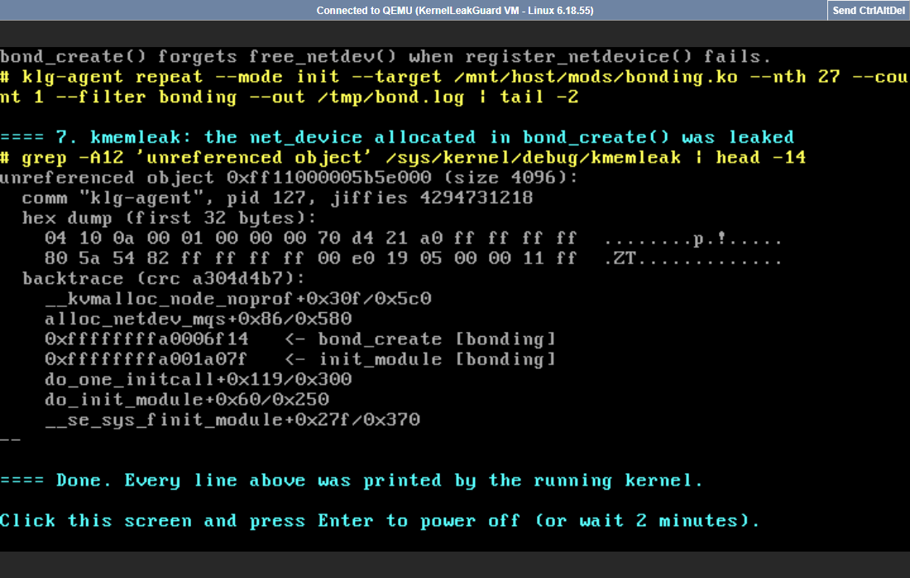

# KernelLeakGuard — Demo Guide

A step-by-step script for showing the project: what to type, what you will
see, and what to say. Everything runs on the laptop (no internet needed).

---

## The project in one minute (easy language)

**The problem.** When something goes wrong inside the Linux kernel (memory runs
out, a device fails), the code takes an *error exit*. Programmers often forget
to give back memory on these exits. That memory is lost until the machine
reboots, so servers and phones slowly leak memory. These bugs are hard to find
because normal testing almost never takes the error exits.

**What our tool does, in three steps.**

1. **Find** — it reads kernel code automatically and points at places where
   memory may not be given back on an error exit, and which failure causes it.
2. **Prove** — it boots *our own Linux kernel* in a virtual machine, makes
   exactly that failure happen, and asks the kernel's own leak detector
   (*kmemleak*) whether memory really leaked.
3. **Fix** — it writes a fix and checks it (it compiles, the warning goes away,
   the leak is gone when tested again).

Every warning ends up **confirmed**, **refuted** or **inconclusive**, with proof.
Earlier research tools (MLEE) stop at step 1 and need a human to check each warning.

---

## Numbers to remember

| What | Number |
|---|---|
| Test set | 32 kernel modules we wrote, with **17 real leaks** and **42 safe** places |
| Our tool | finds **16 of 17** leaks with **0 false alarms** |
| Reading code only | 16 found but **1 false alarm** — the "prove" step removes it |
| Brute force (fail everything) | also 16, but needs **1279** kernel runs; we need **424** |
| cppcheck (free tool) | only **6 of 17** |
| Fixes | a checked fix for **all 15** confirmed leaks |
| Real Linux | **39** real modules, **6376** functions, **9779** failure points tested |
| Smarter analysis | false warnings on real code cut from **115 to 11** |
| Real bug from 2010 | bonding driver bug (fixed by commit 8d6184e4881b) found, proved and fixed again |
| Bugs in today's Linux | **5** found, all still in the latest version (see Step 5) |

---

## Before the demo (10 minutes before)

1. Plug in the charger and turn off sleep, notifications and other apps.
2. Open the **Ubuntu** (WSL) terminal and maximise it. Make the text bigger
   with `Ctrl` + `+` so people at the back can read it.
3. Type these two commands:

```bash
cd ~/KernelLeakGuard
bash scripts/demo_ready.sh --open
```

You should see a list of green **✔** and **Ready.** It also opens the
dashboard (http://localhost:8501), the slides and the report on Windows.
A yellow **!** about KVM is normal: the VM then boots in about 30 seconds.
If anything shows a red **✘**, do what it says next to it.

**4.** In the browser, check that the dashboard opens on **Overview**.

**5.** Arrange the screen: browser (dashboard) and terminal side by side, slides
ready in another window.

---

## The demo (about 15 minutes)

### Step 1 — The problem (2 min) · Om · slides

**Show:** slides 1–4 (title, the problem, why it matters, objectives);
slide 7 (system architecture) if there is time.

**Say:** "Kernel code often stops early when something fails. If it forgets to
free memory there, the kernel leaks memory, but only when that failure really
happens — which normal tests never trigger. Our tool finds these leaks, proves
them inside a real kernel and fixes them."

### Step 2 — Find: reading the code (2 min) · Om · dashboard + terminal

**Show:** dashboard → **Findings**. Below the table, in **Inspect finding**,
choose `klg_l02_goto_ladder · sensor_setup · 32 · 54` (slide 16 explains the
same bug).

**You will see:** the C code with three coloured lines: blue = memory is taken,
orange = the call that fails, red = the exit that forgets to free it.

**Say:** "Our analyser, written in C++ with LLVM, follows every piece of
memory through the code and finds the exit that forgets it. It even tells us
*which* failure leads there."

**Optional, in the terminal:**

```bash
python3 -m klg show | head -12
```

You will see one line per leak with its verdict, e.g.
`klg_l02_goto_ladder:32 sensor_setup() kmalloc leaks at line 54 (-ENOMEM, high) -> confirmed`.

### Step 3 — Prove it inside a real kernel, live (4 min) · Abhishek · terminal + VM screen

**Type in the terminal:**

```bash
python3 scripts/live_demo.py --window
```

**You will see:** a new browser tab opens with the **VM screen**; its title bar
says **"Connected to QEMU (KernelLeakGuard VM - Linux 6.18.55)"**. This is the
screen of a separate virtual computer, like a VirtualBox window. For about 30
seconds it shows the Linux boot messages scrolling, then 7 steps run on their
own, about one minute in total. The terminal shows the same text. Make the tab
full screen with `F11` if you like.

**Say while it runs:**

| On the VM screen | What to say |
|---|---|
| boot messages scrolling | "This is a separate virtual machine booting our own Linux 6.18.55, built with the leak detector and failure injection switched on. It is not the laptop's kernel." |
| `==== 1.` uname, cmdline | "Here you can see the kernel version and that the leak detector (kmemleak) is on." |
| `==== 2.` erofs loads, `0` | "erofs is a real Linux file-system module. Loaded normally, it leaks nothing: kmemleak finds 0." |
| `==== 3.` fault 85 | "Now we make exactly **one** memory request fail while erofs starts — failure number 85, the one our tool picked." |
| `==== 4.` unreferenced object `erofs_pcluster-1` | "kmemleak, the kernel's own detector, reports memory that nobody points to any more: it leaked." |
| `==== 5.` kobject … not initialized / refcount underflow | "And this is the kernel itself complaining. This is a real bug in Linux's memory allocator that our tool found. It is still in the newest Linux, and our 10-line patch fixes it." |
| `==== 6./7.` bonding, size 4096, `bond_create` | "Last, a real bug that Linux had until 2010 in the bonding network driver. We put it back into today's code — the kernel again reports the leaked network device, and the tool's fix removes it." |
| `Click this screen and press Enter …` | Click the VM screen and press **Enter** (or wait 2 minutes) — the virtual machine switches off. |



**If the tab does not open by itself:** open
http://localhost:6080/vnc_lite.html?host=localhost&port=5701&path=&scale=true
(while the demo runs). **Backup:** run the same demo inside the terminal only:

```bash
python3 scripts/live_demo.py
```

Or use the dashboard → **Live kernel** → **▶ Run live demo** (with **Show the
VM's own screen** ticked): the page shows the VM screen and the output together.

### Step 4 — How good is it? (2 min) · Aarav · dashboard

**Show:** dashboard → **Evaluation** (slides 13–14 have the same numbers).

**Say:** "On our test set of 32 modules with 17 known leaks, our tool finds 16
with zero false alarms. Testing every possible failure finds the same number
but needs three times as many kernel runs: 1279 instead of 424. The free
checker cppcheck finds only 6. And every confirmed leak gets a checked fix
(dashboard → **Fix patches**)."

### Step 5 — Real Linux code (3 min) · Aarav · dashboard

**Show:** dashboard → **Real kernel code** (slide 15). Scroll down to
**Root causes of the findings on real code**.

**Say:**

- "We ran it on 39 real Linux modules. At first the code reader gave 115
  warnings; we taught it general kernel rules and brought that down to 11,
  without losing anything on the test set. We checked all 11 by hand: 2 are
  real bugs."
- "In today's Linux the tool found 5 problems, all still in the newest version:"

| # | Bug (plain words) | Found by | Status |
|---|---|---|---|
| 1 | The memory allocator (SLUB) loses whole memory caches when a setup step fails | proving in the VM | our patch: 20 leaked objects → 0 |
| 2 | The f2fs file system leaks names; a fix from April 2026 introduced it | proving in the VM | our patch: 29 → 0 |
| 3 | The ntfs3 file system leaks memory while recovering a disk | reading the code | our patch removes the warning |
| 4 | The ufs file system leaks memory on every delete; reported in 2018, never fixed | reading the code | our patch removes the warning |
| 5 | null_blk / block layer uses memory after it was freed and crashes the kernel | proving in the VM | explained exactly why |

- "The patches are in the `patches/` folder, ready to send to the Linux developers."

### Step 6 — Let sir try it (optional, 2 min) · anyone · VM screen

```bash
python3 scripts/live_demo.py shell --window
```

The VM screen opens in a browser tab with a root prompt (`~ #`). Click it and
type, for example:

```text
uname -a
lsmod
cat /proc/meminfo
ls /mnt/host/mods
poweroff -f
```

`poweroff -f` switches the virtual machine off.

### Optional — type the whole proof yourself, one command at a time

Instead of the automatic demo, you can type every step by hand in the same
shell (`python3 scripts/live_demo.py shell --window`, or without `--window` to
type in the terminal). This exact sequence was tested on 27 Oct 2026.

**The one rule:** kmemleak only reports an object after it has been unreachable
for about 5 seconds, and it needs **two** scans. That is why every check is
`sleep 5; echo scan > $K; echo scan > $K; cat $K`. If you scan only once,
straight away, the list is empty, even when there is a leak.

| # | Type this | What sir sees / what to say |
|---|-----------|-----------------------------|
| 1 | `dmesg -n 1` | Stops kernel messages from interrupting your typing. |
| 2 | `uname -r` | `6.18.55`: a real, current Linux kernel. |
| 3 | `K=/sys/kernel/debug/kmemleak` | A short name for kmemleak's file, so the next lines are shorter. |
| 4 | `ls $K /proc/self/fail-nth` | Both files exist: the leak detector and the fault-injection switch are on. |
| 5 | `insmod /mnt/host/mods/klg_modwatch.ko` | Our helper module, which records where modules are loaded. |
| 6 | `echo scan > $K; echo clear > $K` | Start with a clean list. |
| 7 | `insmod /mnt/host/mods/erofs.ko` | Load the real erofs filesystem driver normally. |
| 8 | `lsmod` | `erofs` appears in the list of loaded modules. |
| 9 | `rmmod erofs` | Unload it again. |
| 10 | `sleep 5; echo scan > $K; echo scan > $K; cat $K` | **Nothing printed.** On the normal path erofs cleans up correctly. |
| 11 | `klg-agent repeat --mode init --target /mnt/host/mods/erofs.ko --nth 85 --count 1 --filter erofs --out /tmp/e.log` | Load erofs again, but make its 85th memory request fail: this forces the error path. |
| 12 | `dmesg | grep -A6 FAULT_INJECTION` | `FAULT_INJECTION: forcing a failure.` The kernel confirms that we caused the failure. |
| 13 | `sleep 5; echo scan > $K; echo scan > $K; cat $K` | **`unreferenced object ... (size 32)` with `erofs_pcluster-1`**, plus objects of 208 and 72 bytes and a 48-byte percpu object. The error path leaked memory: found by our analyser, proved by the kernel. |
| 14 | `dmesg | grep -A2 "not initialized"` | `kobject ... is not initialized, yet kobject_put() is being called`: the kernel's own warning about the same broken cleanup. |
| 15 | `echo clear > $K` | Clean list for the second example. |
| 16 | `klg-agent repeat --mode init --target /mnt/host/mods/bonding.ko --nth 27 --count 1 --filter bonding --out /tmp/b.log` | The historical bonding bug (fixed upstream in 8d6184e4881b). This is the old, buggy version. |
| 17 | `sleep 5; echo scan > $K; echo scan > $K; cat $K` | **A 4096-byte `unreferenced object` from `alloc_netdev_mqs`**, plus several more from the same function: a whole network device was leaked. This is the real bug that Linux later fixed. |
| 18 | `poweroff -f` | Switch the VM off. |

Tips: use the Up arrow to repeat the `sleep 5; ...` line. The scan output is
long, so `cat $K | head -20` shows just the start. The sizes and addresses can
differ a little from run to run; the names (`erofs_pcluster-1`,
`alloc_netdev_mqs`) stay the same.

### Step 7 — Wrap up (1 min) · Om · slides 19–20

**Say:** "So KernelLeakGuard finds early-exit leaks, proves each one inside a
real Linux kernel with the kernel's own leak detector, and fixes them. On real
Linux it found bugs that are still in the newest version."

---

## Who does what

| Person | Part |
|---|---|
| Om Gunjan Gupta | Steps 1, 2 and 7: problem, static analyser, conclusion |
| Abhishek Kumar Singh | Step 3: kernel, virtual machine, failure injection — live |
| Aarav Jain | Steps 4 and 5: evaluation, real kernel results, dashboard |

---

## If something goes wrong

| Problem | What to do |
|---|---|
| Dashboard does not open | Run `bash scripts/demo_ready.sh` again, then reload http://localhost:8501 |
| VM screen tab does not open | Open http://localhost:6080/vnc_lite.html?host=localhost&port=5701&path=&scale=true, or run `python3 scripts/live_demo.py` (terminal only) |
| VM screen says "Disconnected" | The VM has finished or was stopped; start the demo again |
| VM seems stuck | Press `Ctrl`+`C` in the terminal and run it again |
| "a VM is still running" | Wait for it to finish, or run `pkill qemu-system` |
| Anything else | Everything is already recorded: show the dashboard pages and the report (Section 4.4–4.5 has the kernel's output). Nothing depends on the live run |

---

## Questions sir may ask

**"Isn't this just MLEE?"** — "MLEE only reads code, and a person must check
every warning. Ours proves or refutes each warning inside a real kernel and
writes a checked fix."

**"Are these bugs real?"** — "Yes. The five bugs are in today's Linux; we
checked them against the newest version. The bonding bug really existed until
2010. The only bug we invented ourselves (null_blk seed) is clearly marked."

**"Why use a virtual machine?"** — "Making the kernel fail on purpose would
crash the laptop. Kernel developers test the same way (for example syzkaller
and kernel CI)."

**"Why is it a bit slow?"** — "Windows security keeps hardware virtualization
away from our VM, so it uses software emulation. With it the full experiment
takes minutes instead of hours."

**"What can't it do yet?"** — "It only tests code that runs when a module is
loaded. Bugs in code that runs when a disk is mounted (like the ntfs3 and ufs
ones) are confirmed by reading the code, not yet in the VM."

**"Which OS concepts does it use?"** — "Kernel memory management (slab
allocator, kmalloc, kmem_cache), loadable kernel modules, error handling,
virtualization (QEMU), the kernel's fault-injection and kmemleak debugging
facilities, and system calls (`finit_module`, debugfs, `/proc/self/fail-nth`)."
