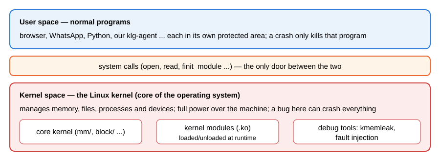
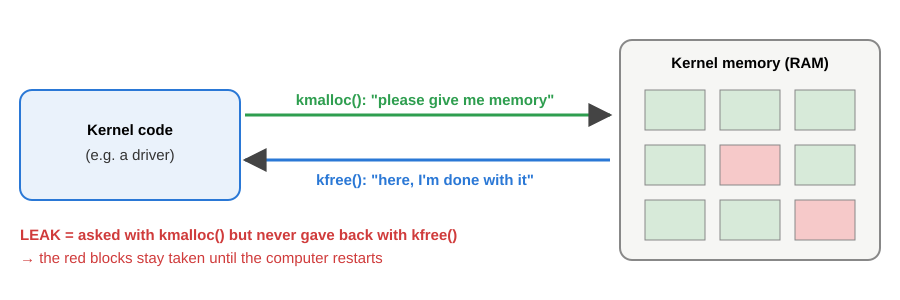
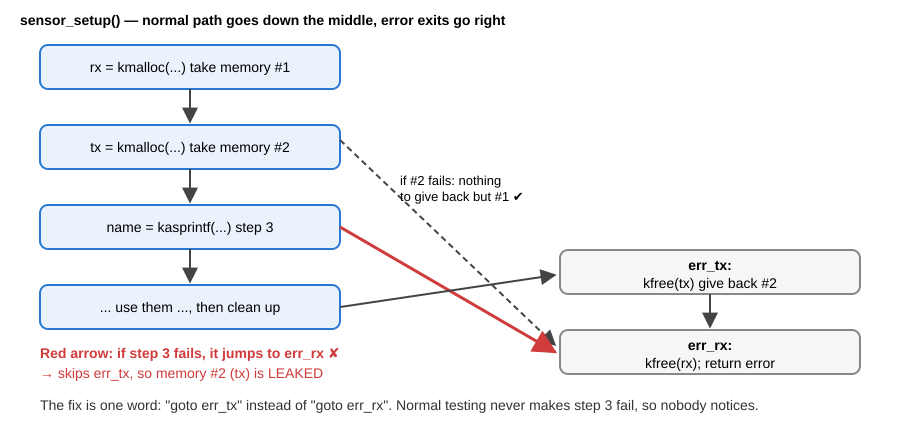
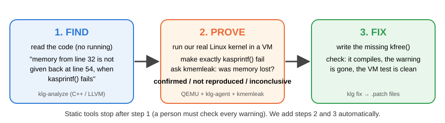
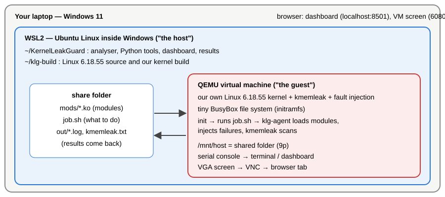
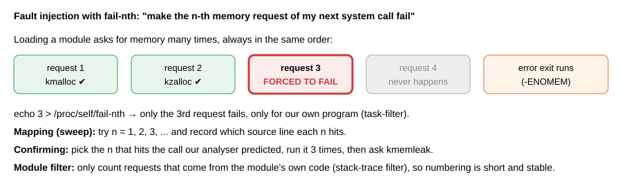
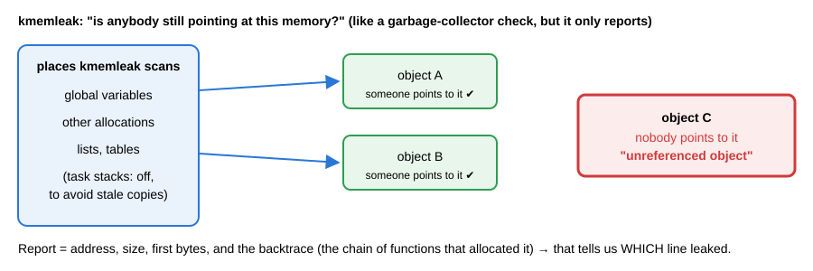
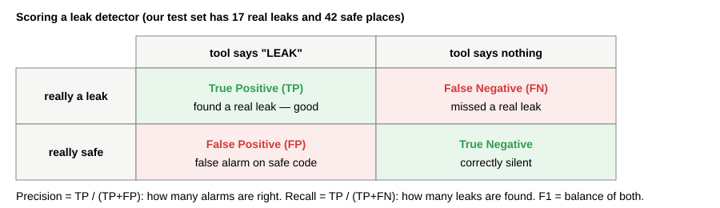
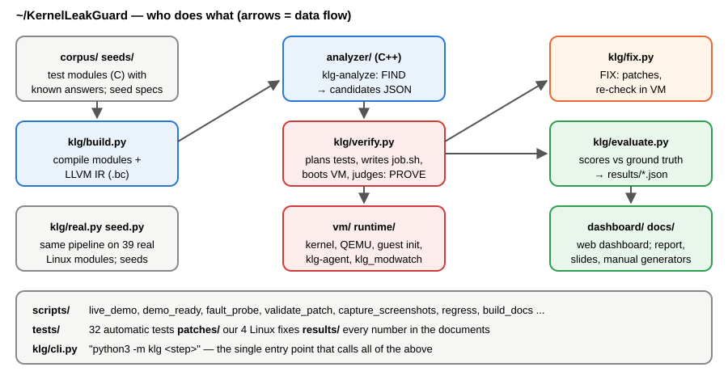

# KernelLeakGuard — The Complete Study Guide

Everything you need to understand the project, explain it, run the demo and
answer questions, in plain language. Every technical word is explained the
first time it appears and again in the **Glossary** (Part D).

**How to read this:** Part A explains the ideas from zero. Part B is the demo.
Part C walks through the code, folder by folder. Part D is the glossary and the
questions you are likely to be asked. Numbers in this guide come from the
latest run stored in `results/`; if you re-run the experiments, check the
dashboard for the current values.

---

# Part A — Understanding the project

## 1. The story in one minute

The Linux kernel (the heart of the operating system on phones and servers)
borrows memory all the time. When something goes wrong — memory runs out, a
device does not answer — kernel code quits early through an **error exit**.
Programmers often forget to give the borrowed memory back on these error exits.
That memory is then lost until the computer restarts: a **memory leak**.

These leaks are hard to find because error exits almost never run during normal
testing. **KernelLeakGuard** finds them in three steps:

1. **Find** — a program reads the kernel code and points at places where memory
   may not be given back, and which failure would cause it.
2. **Prove** — it starts our own copy of Linux in a virtual machine, makes
   exactly that failure happen, and asks the kernel's own leak detector
   (**kmemleak**) whether memory was really lost.
3. **Fix** — it writes the missing line of code and checks that the leak is gone.

On our test set it finds 16 of 17 leaks with **zero false alarms**. On real
Linux code it found bugs that are **still present in the newest Linux**.

## 2. Basic ideas you need

### 2.1 Memory, the operating system and the kernel

A computer's **memory (RAM)** is where running programs keep their data. The
**operating system (OS)** shares memory, the processor, files and devices
between programs. The **kernel** is the core part of the OS that does this
sharing. Linux is a kernel; Ubuntu, Android and Debian are built on it.



- **User space** is where normal programs run (browser, Python, our
  `klg-agent`). Each program is protected from the others; if one crashes, only
  it dies.
- **Kernel space** is where the kernel runs. It has full power over the
  machine, so a bug there can crash or slow down everything.
- **System calls** are the only door between them: a program asks the kernel to
  do something (open a file, load a module) through a system call.

### 2.2 Kernel modules

A **kernel module** is a piece of kernel code that can be loaded and unloaded
while the computer runs, like a plug-in. Its file ends in `.ko` ("kernel
object"). Drivers for devices, file systems and network features are usually
modules. Loading one runs its **init function** (start-up code); unloading runs
its **exit function**. Commands: `insmod` (load), `rmmod` (remove), `lsmod`
(list).

### 2.3 Borrowing memory: kmalloc and kfree

Kernel code asks for memory with `kmalloc()` (or `kzalloc()`, which also fills
it with zeros) and must give it back with `kfree()`. Large blocks use
`vmalloc()` / `vfree()`. Objects that are created very often come from a
**slab cache** (`kmem_cache_alloc()` / `kmem_cache_free()`): a ready-made pool of
same-sized objects. The part of the kernel that hands out this memory is the
**memory allocator**; in Linux the main one is called **SLUB**.

### 2.4 What a memory leak is



A **memory leak** happens when code borrows memory and loses track of it
without giving it back. In a normal program the memory is returned when the
program exits. **The kernel never exits**, and it has no garbage collector
(an automatic cleaner, like in Java or Python), so leaked kernel memory stays
lost until reboot. Many small leaks slowly eat memory; if an attacker can
trigger a leak again and again, they can bring the machine down — a
**denial-of-service** attack.

## 3. The problem statement

### 3.1 Error exits and clean-up ladders

Kernel functions often do several steps, each of which can fail. If step 3
fails, the function must undo steps 1 and 2 and return an **error code** such
as `-ENOMEM` ("out of memory"). Kernel programmers use a **clean-up ladder**:
labels at the end of the function, reached with `goto`, each undoing one step.
A path that leaves the function early because of an error is an **error exit**
(also called an **early-exit path** or **error path**).



In the picture, when step 3 fails the code jumps to the wrong label and skips
`kfree(tx)`: memory #2 leaks. This is exactly our benchmark module `klg_l02`.

### 3.2 Why this is hard

- **Error exits rarely run.** Memory almost never runs out during testing, so
  the buggy line never executes and nobody notices.
- **The kernel is huge** — tens of millions of lines. Nobody can read it all.
- **Existing tools fall short:**
  - **Static analysis** (reading the code without running it) can look at every
    path, but it guesses. It produces **false positives** (false alarms) that a
    person must check one by one. The research tool **MLEE** works this way.
  - **Dynamic analysis** (running the code and watching) gives real evidence,
    but only for code it happens to run. **Fuzzing** tools like **syzkaller**
    work this way.
  - Simple checkers like **cppcheck** find only obvious patterns.

**Problem statement (one sentence):** automatically find memory leaks on the
error exits of Linux kernel code, prove each one with evidence from a real
running kernel instead of leaving it to a person, and produce a checked fix.

## 4. What we built — the idea



The key idea: **the static analysis aims, the running kernel proves.** The
analyser does not just say "maybe a leak here" — it also says *which call must
fail* to reach the leak (the **trigger**). That lets the runtime part fail
exactly that one call instead of trying everything.

## 5. Step 1 — FIND (the static analyser)

### 5.1 From C code to something we can analyse

Kernel code is written in **C**. A **compiler** turns C into machine code. We
use the **clang** compiler, which belongs to the **LLVM** project. LLVM first
turns the program into **LLVM IR** ("intermediate representation"): a simple,
very regular version of the program that is much easier to analyse than C. The
file form of IR is called **bitcode** (`.bc`). The kernel's own build system,
**kbuild**, knows the exact compiler options for each file; we re-run its
command with one extra option (`-emit-llvm`) to get the IR. So the analyser sees
exactly what the real kernel build sees.

### 5.2 How the analyser thinks

Our analyser is **klg-analyze**, written in **C++** on top of the LLVM
libraries (`analyzer/src/Analyzer.cpp`). For every place where memory is taken
(an **allocation site**, e.g. "the `kmalloc` on line 32"), it:

1. **Collects aliases** — every copy of the pointer (an **alias** is another
   name for the same memory: `p`, `q = p`, `s->buf = p` ...).
2. **Notes events** — where the memory is given back (**release**: `kfree`),
   handed to someone else (**escape** / **ownership transfer**: stored in a
   global list, passed to a function that keeps it), or returned to the caller.
3. **Searches every path** from the allocation to every `return` of the
   function, using **depth-first search (DFS)** — follow one possible way
   through the code to the end, then back up and try the next.
4. **Reports a leak** for a path that reaches a `return` without any release or
   hand-over.

Rules that remove impossible or harmless paths (each removes false alarms):

- **The allocation itself failed** (`p == NULL`, or `IS_ERR(p)` for functions
  that return an **ERR_PTR** error code instead of NULL): nothing to free.
- **Branch correlation:** if the code tested a condition earlier (e.g.
  `if (err)`), a later test of the same condition must give the same answer.
- **Constant conditions:** if a value is known on this path (e.g. a clean-up
  selector that is always 0 or 8), only the matching branch can run.
- **Ownership:** if a helper function puts the new object into a list or hash
  table before returning it, the caller does not own it; that is a lookup, not
  an allocation.
- **Conditional ownership:** `register_netdevice()` takes ownership only if it
  succeeds; on failure the caller must still free.

**Function summaries (interprocedural analysis):** to follow memory into other
functions, the analyser first computes a small summary of every function in the
module: does it free its argument? keep it? return new memory? Then a call to
that function is treated using its summary.

**The trigger:** for each leaking path the analyser records which failing call
chose that path (e.g. "`kasprintf()` on line 38 returned NULL") and the error
code that is returned. It also gives a **confidence** (high / medium / low) and
the line where a fix should go.

### 5.3 What it outputs

A **JSON** file (a simple text format for data) with one entry per suspected
leak, called a **candidate** or **warning**:

```json
{ "function": "sensor_setup", "allocator": "kmalloc",
  "alloc": {"line": 32}, "exit": {"line": 54}, "return_value": "-ENOMEM",
  "triggers": [{"callee": "kasprintf", "line": 38}], "confidence": "high" }
```

## 6. Step 2 — PROVE (runtime verification)

### 6.1 Why a virtual machine

We are going to make the kernel fail on purpose. Doing that on the laptop's own
kernel would crash it. So we run a separate computer inside the computer: a
**virtual machine (VM)**. **QEMU** is the program that creates it. The VM runs
**our own build of Linux 6.18.55** (an **LTS**, long-term-support, version).



- **WSL2** (Windows Subsystem for Linux) runs Ubuntu inside Windows. Our tools
  run there; we call it **the host**.
- The VM is **the guest**. It has its own kernel, a tiny file system called an
  **initramfs** (built with **BusyBox**, a single small program that provides
  all the basic Linux commands), and a **shared folder** with the host (using
  the **9p** protocol) through which jobs go in and results come out.
- **KVM** is hardware help that makes VMs fast. On this laptop Windows security
  (Windows Hello's protection, which needs **VBS**, virtualization-based
  security) keeps KVM unavailable inside WSL, so QEMU uses **TCG** (software
  emulation): correct but 10–20 times slower.
- The guest's **serial console** (a text line, like an old terminal cable)
  sends its text to our terminal and dashboard. Its **screen** (VGA) can be
  shown in the browser through **VNC** (a protocol for showing a remote screen)
  and the **noVNC** viewer.

### 6.2 Our kernel's special features

We build the kernel with **clang** and switch on (in `vm/kernel.config.fragment`):

- **kmemleak** — the leak detector (6.4).
- **Fault injection** — the ability to make memory requests fail on purpose
  (6.3): **failslab** (slab allocations), **fail_function** (chosen functions),
  **fail_usercopy** (copies from user space).
- **ftrace-based kprobes** — needed so function-failure injection works for our
  task (a lesson we learned the hard way).
- Settings that keep kmemleak honest (6.4): no stack scanning, stack erasing,
  and zeroing memory on allocation and free (`init_on_alloc=1 init_on_free=1`).

### 6.3 Fault injection with fail-nth



Writing a number *n* into `/proc/self/fail-nth` tells the kernel: "make the
*n*-th memory request of my next system call fail". Each possible failure is a
**fault point**. Loading a module makes its memory requests in the same order
every time, so *n* identifies a specific line of code.

- **Sweep / mapping run:** our agent loads the module with n = 1, 2, 3 ... and
  records where each failure happened (the **stack trace**: the chain of
  functions that were running). That builds a map "fault number → source line".
- **Module filter:** with the **stack-trace filter** (`require-start` /
  `require-end`), only requests made from the module's own code are counted.
  This keeps the numbering short and stable.
- **Confirmation run:** for each candidate we pick the n that fails its
  trigger call, run it 3 times, then ask kmemleak.
- **task-filter:** only our own program gets failures; otherwise the whole
  guest (including its PID 1, the first process) would break.

### 6.4 kmemleak — the proof



**kmemleak** remembers every allocation. When asked to **scan**, it looks
through the kernel's memory for values that look like pointers to each
allocation. An allocation that nobody points to is reported as an
**unreferenced object**, with its size, first bytes and **backtrace** (the
functions that allocated it). That backtrace tells us which line leaked.

**Stale pointers** are old copies of an address left in reused memory or on an
old **stack** (the scratch memory a function uses while it runs). kmemleak
would think "someone still points to it" and miss the leak. That is why we
erase stacks and zero memory.

**klg_modwatch:** when a module fails to load, Linux removes it before
kmemleak reports, so its functions show up only as raw numbers
(`0xffffffffa000f2a7`). Our small helper module logs every module's addresses
and function names (its **symbols**), so we can turn the numbers back into
names and lines (**symbolisation**, using the kernel's **faddr2line** script).

### 6.5 The verdict

| Verdict | Meaning |
|---|---|
| **confirmed** | The predicted failure was injected and kmemleak reported an object allocated at the predicted line. Real leak, with proof. |
| **not reproduced** | The path was run but nothing leaked → the warning was a false alarm (refuted). |
| **inconclusive** | The trigger could not be made to fail (e.g. the code only runs when a disk is mounted). We cannot say. |

**Crash recovery:** sometimes failing an allocation crashes the guest kernel.
The host notices (no progress for a while, or a crash message), records it,
reboots the VM and continues where it stopped.

## 7. Step 3 — FIX

For each confirmed leak the tool writes a **patch** (a small file that shows
which lines to add or remove — the **diff** format used by Linux developers).
It reuses the clean-up line the function already has (e.g. jump to `err_tx`)
or adds the right `kfree()`. Then it **validates** the patch three ways: it
**compiles**, the analyser no longer warns (**static clean**), and the VM test
no longer leaks (**runtime clean**). Result: checked fixes for all 15
confirmed leaks (14 fully, 1 at runtime only).

## 8. How we measured it

### 8.1 The test set (benchmark / corpus)

We wrote **32 small kernel modules** (`corpus/`): 17 places that leak and 42
places that are safe but tricky (memory put in a list, freed by a helper, freed
in a loop, reference counted). Each allocation line is labelled
`/* GT:LEAK */` or `/* GT:SAFE */` — the **ground truth** (the right answers).

### 8.2 The scores



### 8.3 What we compared

| Approach | Found (TP) | False alarms (FP) | Missed (FN) | Notes |
|---|---|---|---|---|
| Naive "missing kfree" check | 16 | 11 | 1 | many false alarms |
| Our static analyser alone | 16 | 1 | 1 | |
| **KernelLeakGuard complete** | **16** | **0** | **1** | **424** kernel runs |
| Fail every allocation (exhaustive) | 16 | 0 | 1 | **1279** runs, no explanation |
| Random failures | 14 | 0 | 3 | |
| cppcheck | 6 | 1 | 11 | |

- **Baselines** are the simpler methods we compare against.
- **Ablation:** switch off one feature of the analyser at a time to see how
  much each helps (e.g. without ownership handling, false alarms jump).
- The one leak we miss (`klg_l16`) hides memory inside another heap object —
  a known limitation. The one static false alarm (`klg_s09`, a correct
  clean-up loop) is refuted by the runtime step.

## 9. Real Linux code

### 9.1 What we did

We ran the tool on **39 real Linux modules** that need no special hardware
(virtual network devices, file systems, block-device simulators, sound and
input drivers). All 39 were run in the VM, testing 9779 fault points of their
start-up code.

Real code is messier than our test set. The first run gave **115** warnings,
mostly false alarms. We taught the analyser general rules (5.2) and brought it
down to **11**, without losing anything on the test set. We checked all 11 by
reading the source: **2 are real bugs**, 9 are false alarms with known causes.

### 9.2 Bugs found in today's Linux

All checked against the newest Linux (**mainline** = the main development
version, 7.3 at the time; **linux-next** = changes waiting to go in). Each
change to Linux is a **commit** with an ID like `8d6184e4881b`; **upstream**
means "the official Linux project"; **stable** means older maintained versions
that receive backported fixes.

| # | Bug, in plain words | How found | Our fix |
|---|---|---|---|
| 1 | **SLUB** (the memory allocator) loses a whole slab cache when registering it in **sysfs** (the `/sys` folder that shows kernel objects) fails. Seen while erofs, f2fs, hfsplus and nilfs2 start. | proving step | patch 0001, tested in the VM: 20 lost objects → 0 |
| 2 | **f2fs** (a file system) forgets to release the names of two **kobjects** (kernel objects shown in sysfs) when adding them fails. A fix from April 2026 (commit b635f2ecdb) introduced it. | proving step | patch 0003, tested: 29 → 0 |
| 3 | **ntfs3** (Windows NTFS file system) leaks memory while replaying its journal after a crash. | reading code | patch 0002, checked by re-analysis |
| 4 | **ufs** (a Unix file system) leaks a small buffer header every time it frees an indirect block; reported in 2018 but never fixed. | reading code | patch 0004, checked by re-analysis |
| 5 | **null_blk / block layer**: a **use-after-free** (using memory after it was freed) of module memory, which crashes the kernel when a module fails to start after adding a disk. | proving step (crash) | explained; no fix (the obvious one breaks a kernel rule) |

Our patches are in `patches/`. They have **not** been sent to the Linux
developers; that is the user's decision, after checking the mailing lists for
existing fixes.

### 9.3 Real bugs put back on purpose (seeds)

Real modules contain few leaks in start-up code, so to show the **whole loop**
on real code we **re-introduced** leaks:

- **bonding, `bond_create()`** — a **real historical bug**: Linux had it until
  2010, when commit 8d6184e4881b added the missing `free_netdev()`. We removed
  that line again. The tool detected it, proved it in the VM (kmemleak reports
  the leaked 4096-byte network device) and fixed it.
- **null_blk, `null_alloc_dev()`** — a leak we planted ourselves (clearly
  marked), also detected, proved and fixed.

## 10. Honest limitations

- The runtime step only runs **module start-up code**. Bugs in code that runs
  when a disk is mounted or a special command is given (like the ntfs3 and ufs
  ones) are confirmed only by reading the code.
- Memory hidden inside another heap object (klg_l16) is missed.
- Without KVM the VM is slow (a full run of all 39 modules takes about 3 hours).
- One module (snd_dummy) hung the guest at some fault points; we did not
  investigate why.

---

# Part B — The demo

The step-by-step script with what to say is in **`DEMO.md`**
(PDF: `KernelLeakGuard_Demo_Guide.pdf`). In short:

```bash
cd ~/KernelLeakGuard
bash scripts/demo_ready.sh --open           # checks everything, opens dashboard + slides
python3 scripts/live_demo.py --window       # LIVE: the VM screen opens in the browser
python3 scripts/live_demo.py shell --window # let sir type commands in the VM
```

**What the live demo shows (about one minute after a ~30 s boot):**

| Screen | What it means |
|---|---|
| Boot messages scrolling | our own Linux 6.18.55 starting in QEMU |
| `==== 1.` uname, cmdline, kmemleak files | proof it is our kernel with the leak detector and fault injection |
| `==== 2.` erofs loads, `0` | a real module loads normally: no leak |
| `==== 3.` fault 85, FAULT_INJECTION lines | exactly one memory request fails during erofs start-up |
| `==== 4.` unreferenced object `erofs_pcluster-1` | kmemleak reports the lost slab cache — bug #1 |
| `==== 5.` kobject … not initialized / refcount underflow | the kernel itself warning about the SLUB bug |
| `==== 6./7.` bonding, size 4096, `bond_create` | the 2010 bonding bug caught again |
| `Click this screen and press Enter` | press Enter in the VM screen to switch it off |

**Dashboard pages (http://localhost:8501):**

| Page | What it shows |
|---|---|
| Overview | the headline numbers of the test set |
| Findings | every warning with its verdict; pick one to see the source with the allocation (blue), failing call (orange) and leaking exit (red) |
| Fix patches | generated patches and whether they compile / are static-clean / runtime-clean |
| Real kernel code | the 39 real modules, the 11 warnings with review notes, sweep leaks, root causes, seeds |
| Live kernel | runs the live demo or a kernel shell and shows the VM console (and screen) |
| Evaluation | the comparison table and precision/recall chart |
| Run pipeline | runs any step (`python3 -m klg <step>`) with a live log |

---

# Part C — The code, folder by folder



Everything is in `~/KernelLeakGuard` (inside WSL). The Linux source and our
kernel build live outside it, in `~/klg-build` (about 5 GB; recreated by
`vm/build_kernel.sh`).

## 11. Top level

| Path | What it is |
|---|---|
| `README.md` | short project description and quick-start commands |
| `HANDOFF.md` | the complete technical state of the project (for the team and future work) |
| `DEMO.md` | the demo script |
| `GUIDE.md` | this guide |
| `requirements.txt` | Python packages for the dashboard and documents |
| `.gitignore` | files git should not store (build outputs, the venv, scratch files) |
| `.venv/` | the Python **virtual environment** (a private set of Python packages) |
| `.scratch/` | temporary working files (not in git) |

## 12. `analyzer/` — the static analyser (C++, Om)

| File | What it does |
|---|---|
| `Makefile` | builds `analyzer/build/klg-analyze` against LLVM 21 (`make -C analyzer`) |
| `src/main.cpp` | command line: reads a `.bc` file, options (`--naive`, `--no-escape`, ... for ablation, `--spec` for extra allocators), writes JSON |
| `src/Spec.h/.cpp` | the **knowledge tables**: which functions allocate (`kmalloc`, `alloc_netdev_mqs` ...), which free and which argument (`kfree` 0, `kmem_cache_free` 1 ...), which never keep a pointer (`memcpy`, `mutex_lock` ...), which take ownership only on success (`register_netdevice`) |
| `src/Analyzer.h` | data structures: options, function summaries, a candidate (allocation, exit, triggers, fix point) |
| `src/Analyzer.cpp` | the analysis itself (below) |

Inside `Analyzer.cpp`, in order:

1. **`prepare()`** — cleans up the IR: folds constant configuration stubs,
   turns stack variables into plain values (LLVM's `mem2reg`), removes
   unreachable code.
2. **`FlowTracker`** — for one pointer, collects all aliases (copies, casts,
   fields in local structures) and the events: release, escape (store
   outside / pass to a function that keeps it), return. `publishes()` says
   whether the object is stored into outside memory.
3. **`computeSummaries()`** — for every function: does it free / keep / return
   / publish each pointer argument; does it return fresh memory the caller
   owns.
4. **`SiteAnalysis`** — for one allocation: `dfs()`/`dfsBlock()` walk all paths
   with the pruning rules (NULL/IS_ERR edge, branch correlation, constant
   conditions, pending conditional ownership); `recordLeak()` builds a
   candidate with trigger, error code, confidence and fix point.
5. **`toJSON()`** — writes the report.

## 13. `vm/` and `runtime/` — the kernel, the VM and the agent (Abhishek)

| File | What it does |
|---|---|
| `vm/env.sh` | shared paths: kernel version, source dir, build dir, bzImage, initramfs |
| `vm/build_kernel.sh` | downloads Linux 6.18.55, checks its checksum, configures and builds it with clang (10–25 min) |
| `vm/kernel.config.fragment` | the kernel options we switch on (kmemleak, fault injection, kprobes, 9p ...) |
| `vm/real_modules.fragment` | the 39 real modules built as `.ko` |
| `vm/build_initramfs.sh` | builds the guest's tiny file system: BusyBox + `klg-agent` + `init` |
| `vm/init` | the guest's first program: mounts `/proc`, `/sys`, debugfs, the 9p share; configures fault injection and kmemleak; runs `job.sh` or opens a shell; powers off |
| `vm/run_vm.sh` | starts QEMU (KVM if possible, else TCG) with the share, records the console |
| `vm/build_corpus.sh` | builds the 32 benchmark modules |
| `runtime/klg-agent.c` | the agent inside the guest. **sweep** mode: fail-nth = 1, 2, 3 ... and log each attempt; **repeat** mode: inject one chosen n several times (and a random mode for the baseline). Prints `@@BEGIN/@@ATTEMPT/@@END` markers the host parses |
| `runtime/modwatch/klg_modwatch.c` | helper kernel module: logs each module's load address and function symbols (`KLG-MOD`, `KLG-SYM`) |

## 14. `corpus/` and `seeds/` — test data (Aarav)

| Path | What it is |
|---|---|
| `corpus/klg_l01 … klg_l17*.c` | leaking test modules (one bug pattern each: wrong goto, loop, wrapper, kstrdup, vmalloc ...) |
| `corpus/klg_s01 … klg_s15*.c` | safe test modules with tricky but correct code |
| `corpus/klg_harness.h` | `KLG_TRIGGER(fn)` makes a function callable through a debugfs file, so tests can run it on demand |
| `seeds/*.json` | the re-introduced leaks: which file, which function, which line to remove, the story, and (for bonding) the historical commit |

## 15. `klg/` — the Python orchestrator (Aarav)

Run as `python3 -m klg <step>`.

| File | What it does |
|---|---|
| `cli.py` | the commands: `build`, `analyze`, `verify`, `evaluate`, `show`, `fix`, `real`, `seed`, `all` |
| `config.py` | paths (project, kernel build, results) |
| `build.py` | builds modules and re-runs each kbuild compile command with `-emit-llvm` → `.bc` |
| `analyze.py` | runs `klg-analyze` on each module (and the ablation variants) → `results/static/` |
| `ground_truth.py` | reads the `GT:LEAK` / `GT:SAFE` labels |
| `verify.py` | the runtime brain: writes the guest job (`job.sh`), boots the VM (with crash/hang recovery), builds the fault map from the sweep, matches candidates to fault points, schedules confirmation rounds, and judges verdicts |
| `evidence.py` | parses the agent logs and kmemleak reports; turns stack frames into source lines (faddr2line, klg_modwatch symbols) |
| `evaluate.py` | compares every approach with the ground truth → `results/evaluation.json` |
| `fix.py` | writes patches for confirmed leaks and validates them (compile, re-analyse, VM re-run) |
| `real.py` | the same pipeline on the 39 real modules → `results/real/` |
| `seed.py` | re-introduces a leak from `seeds/*.json`, builds the module out of tree, and runs detect → confirm → fix |
| `figures.py` | charts and terminal-style images for the documents |

## 16. `dashboard/` — the web dashboard

| Path | What it does |
|---|---|
| `app.py` | the **Streamlit** app (Streamlit turns a Python script into a web page). Reads `results/` and shows the pages listed in Part B. Also starts pipeline steps and the live kernel in the background. URL options `?page=`, `?section=` open a page directly |
| `novnc/` | the noVNC viewer (open-source, MPL-2.0) that shows the VM screen in the browser |

## 17. `scripts/` — helpers

| Script | What it does |
|---|---|
| `live_demo.py` | the live demo / kernel shell (`--window` = VM screen in the browser) |
| `demo_ready.sh` | checks everything before a demo, starts the dashboard, opens docs |
| `fault_probe.py` | runs a module's start-up with chosen fault numbers and saves kmemleak + kernel log (used to root-cause the real bugs) |
| `build_patched_kernel.sh` | builds a guest kernel with one patch (used to validate the SLUB fix) |
| `validate_patch.py` | builds a module with a patched file and compares the analyser's warnings |
| `make_real_triage.py` | our manual review labels for the real-module warnings |
| `make_root_causes.py` | collects the evidence for the 5 kernel bugs → `results/real/root_causes.json` |
| `rejudge_real.py` | refreshes real-module verdict reasons without re-running the VM |
| `regress.sh` | regression check after analyser changes (corpus in 6 variants + real code) |
| `try_static.py` | quick corpus score of the analyser (must stay TP=16 FN=1 FP=1) |
| `capture_screenshots.py`, `winshot.ps1` | take the screenshots used in the documents |
| `build_docs.sh`, `export_pdf.ps1`, `build_demo_guide.py`, `render_pdf.py` | build the documents, export PDFs, preview pages |
| `setup_venv.sh`, `install_cppcheck.sh`, `repeat_runs.sh` | setup and repeated runs |

## 18. `tests/`, `patches/`, `docs/`, `results/`

| Path | What it is |
|---|---|
| `tests/test_klg.py` | 29 tests: log parsing, planning, real-module handling, and the analyser on test modules and on `tests/analyzer_cases/klg_cases.c` (small C examples of the real-code patterns) |
| `tests/test_dashboard.py` | 3 tests: every dashboard page renders; the Run button works |
| `patches/0001…0004` | our four Linux fixes with explanations |
| `docs/build_*.py`, `report_lib.py` | generate the report, proposal, Review-I, manual and slides from `results/` (no number is typed by hand) |
| `docs/figures/` | charts, diagrams and screenshots |
| `docs/templates/` | the VIT report template and course guidelines |
| `results/static/` | analyser reports for the test set |
| `results/runtime/` | VM runs for the test set (`verification.json` = verdicts) |
| `results/evaluation.json` | all scores |
| `results/fixes/` | generated patches and validation |
| `results/real/` | real-module results: `summary.json`, `triage.json`, `root_causes.json`, probe evidence |
| `results/seeded/` | the re-introduced leaks and their evidence |

## 19. How the pieces run together (data flow)

```text
corpus/*.c ──build.py──► *.ko + *.bc ──klg-analyze──► results/static/*.json (candidates)
                                                            │
     verify.py: plan fault numbers, write job.sh  ◄─────────┘
            │
            ▼  (QEMU guest: init → job.sh → klg-agent + kmemleak)
     out/*.log, kmemleak.txt ──evidence.py──► verdicts (results/runtime/verification.json)
            │
            ├──► evaluate.py ──► results/evaluation.json ──► dashboard, documents
            └──► fix.py ──► results/fixes/ (patches, validated in the VM)
```

`python3 -m klg all` runs build → analyse → verify → evaluate; `klg fix`,
`klg real` and `klg seed` run the other parts.

---

# Part D — Reference

## 20. Glossary (A–Z)

| Term | Meaning |
|---|---|
| Ablation | turning off one feature at a time to measure how much it helps |
| Alias | another name/copy of the same pointer |
| Allocation site | the line where memory is requested |
| Allocator | the kernel code that hands out memory (SLUB, vmalloc) |
| Backtrace / stack trace | the chain of functions that were running at a moment (e.g. when memory was allocated) |
| Baseline | a simpler method used for comparison |
| Benchmark / corpus | our 32 test modules with known answers |
| Bitcode (.bc) | the file form of LLVM IR |
| Branch correlation | treating two tests of the same condition consistently |
| BusyBox | one small program that provides all basic Linux commands; used inside the VM |
| bzImage | the compressed Linux kernel file that QEMU boots |
| Candidate / warning | a suspected leak reported by the analyser |
| clang | the C compiler from the LLVM project |
| Commit | one recorded change in git / in Linux, with an ID like 8d6184e4881b |
| Confidence | how sure the analyser is (high/medium/low) |
| Confirmed | verdict: leak proven by kmemleak |
| cppcheck | a free static checker for C/C++ we compared against |
| Debugfs | a special folder (`/sys/kernel/debug`) with kernel debugging controls |
| Denial of service | making a system unusable, e.g. by exhausting memory |
| DFS (depth-first search) | exploring one path to the end before trying the next |
| Diff / patch | a file listing lines to remove (`-`) and add (`+`) |
| Dynamic analysis | studying a program by running it |
| `-ENOMEM` | kernel error code "out of memory" (other examples: `-EINVAL`, `-EFAULT`) |
| ERR_PTR / IS_ERR | a pointer that carries an error code instead of an address, and the check for it |
| Error exit / early exit / error path | leaving a function early because something failed |
| Escape / ownership transfer | memory handed to someone else who will free it |
| F1 | one score that balances precision and recall |
| faddr2line | kernel script that turns `function+offset` into a source line |
| Fault injection | making operations fail on purpose to test error handling |
| Fault point | one place where a failure can be injected |
| fail-nth | `/proc/self/fail-nth`: fail the n-th request of the next system call |
| failslab / fail_function / fail_usercopy | kinds of fault injection (slab allocations / chosen functions / user copies) |
| False negative (FN) | a real leak the tool misses |
| False positive (FP) | a false alarm on safe code |
| Fuzzing | running a program with many random inputs to find bugs (e.g. syzkaller) |
| Garbage collector | automatic memory cleaner (Java, Python); the kernel has none |
| Ground truth | the known correct answers (GT:LEAK / GT:SAFE labels) |
| Guest / host | the VM and the computer running it |
| Inconclusive | verdict: the failure could not be triggered |
| init / init function | the first program of a system; the start-up function of a module |
| initramfs | a tiny file system loaded with the kernel at boot |
| insmod / rmmod / lsmod | load / remove / list kernel modules |
| Interprocedural | following data across function calls |
| IR (LLVM IR) | a simple intermediate form of a program used by compilers and analysers |
| JSON | a simple text format for structured data |
| kbuild | the Linux kernel's build system |
| Kernel | the core of the operating system |
| Kernel module (.ko) | kernel code that can be loaded and unloaded at runtime |
| kmalloc / kzalloc / kfree | ask for / ask for zeroed / give back kernel memory |
| kmem_cache | a slab cache: a pool of same-sized objects |
| kmemleak | the kernel's built-in memory leak detector |
| kobject | a kernel object that appears in sysfs (`/sys`) |
| kprobes / ftrace | kernel mechanisms to hook into functions (needed for fail_function) |
| KVM / TCG | hardware-assisted (fast) / software-emulated (slow) virtual machines |
| LLVM | a compiler toolkit; we use its libraries to analyse code |
| LTS | long-term-support version |
| Mainline / linux-next / stable | the main Linux development tree / changes waiting to go in / maintained older versions |
| Memory leak | memory borrowed and never given back |
| MLEE | 2021 research tool that finds error-exit leaks statically |
| noVNC / VNC | showing a computer's screen remotely (here: the VM screen in the browser) |
| Not reproduced | verdict: the path ran and nothing leaked (false alarm refuted) |
| Operating system (OS) | software that manages a computer's hardware for programs |
| Precision | share of alarms that are real leaks |
| Process / PID | a running program / its number (PID 1 = the first process) |
| QEMU | the program that creates our virtual machine |
| Recall | share of real leaks that are found |
| Reference count (refcount) | a counter of how many users an object has; freed at zero |
| Root cause | the real underlying reason for a bug |
| Seed (bug seeding) | putting a known bug into code on purpose to test a tool |
| Serial console | a simple text connection to a machine |
| Slab / SLUB | the kernel's allocator for small objects / its current version |
| Stack | scratch memory a function uses while it runs |
| Stale pointer | an old copy of an address that makes freed/leaked memory look used |
| Static analysis | studying a program without running it |
| Streamlit | Python library that turns a script into a web app (our dashboard) |
| Summary (function summary) | short facts about a function (frees / keeps / returns its argument) |
| Symbol / symbolisation | a function's name / turning addresses back into names and lines |
| syzkaller | Google's kernel fuzzer |
| sysfs | the `/sys` folder that shows kernel objects |
| System call | how a program asks the kernel to do something |
| Trigger | the call whose failure leads onto the leaking path |
| True positive (TP) | a real leak the tool reports |
| Upstream | the official Linux project |
| Use-after-free | using memory after it was given back (a serious bug) |
| User space / kernel space | where normal programs run / where the kernel runs |
| VBS | Windows virtualization-based security (keeps KVM away from WSL here) |
| Verdict | confirmed / not reproduced / inconclusive |
| Virtual machine (VM) | a computer simulated by software |
| vmalloc / vfree | kernel allocation for large blocks |
| WSL2 | Windows Subsystem for Linux (Ubuntu inside Windows) |
| 9p | the protocol that shares a folder between host and VM |

## 21. Questions you may be asked

**What problem does the project solve?** Memory leaks on the error exits of
Linux kernel code: memory that is not given back when a function fails. They
are hard to find because error exits rarely run.

**What is new compared with MLEE?** MLEE reads code and reports possible leaks;
a person must check each one. We also prove or refute every warning inside a
real running kernel and produce a checked fix.

**How do you make an error exit happen?** With the kernel's fault injection
(`fail-nth`): we make exactly the n-th memory request fail. The analyser tells
us which call must fail; a mapping run tells us its number.

**How do you know memory leaked?** kmemleak, the kernel's own detector, scans
memory and reports objects nobody points to, with the call stack that
allocated them; we match that to the predicted line.

**Why a virtual machine?** Failing the kernel on purpose would crash the
laptop. A VM is safe, repeatable and can be restarted automatically.

**What OS concepts are used?** Kernel memory management (slab, kmalloc,
vmalloc), kernel modules, error handling, system calls, `/proc` and debugfs,
virtualization, Linux system programming, performance analysis.

**What are your results?** On 32 test modules: 16 of 17 leaks with zero false
alarms, using 424 kernel runs instead of 1279 for blind testing; checked fixes
for all 15 confirmed leaks. On 39 real modules: warnings cut from 115 to 11,
five bugs explained that are still in the newest Linux, and a real 2010 bug
caught end to end.

**Are the bugs really new?** They are in the newest Linux (checked); the ufs
one was reported in 2018 but never fixed; we have not yet searched every
mailing list, so we do not claim them as new discoveries before doing that.

**What can't it do?** It only exercises module start-up code; leaks hidden
inside other heap objects are missed; without KVM it is slow.

**Who did what?** Om — static analyser (C++/LLVM). Abhishek — kernel build,
virtual machine, fault-injection agent. Aarav — test set, Python verifier,
evaluation, dashboard. All of us — testing, documents, demo.
